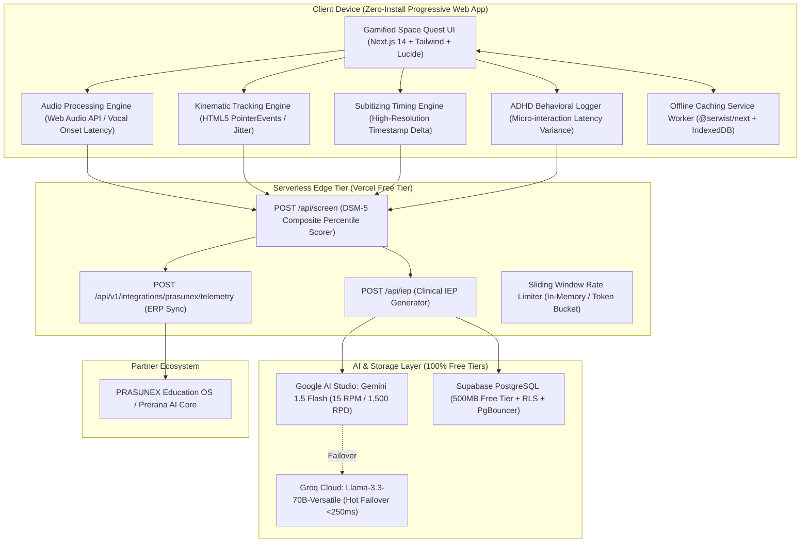

# VidyaSathi (विद्यासाथी) — System Architecture

> **Turnkey AI Screening & IEP Module for PRASUNEX Education OS**  
> **Team:** Dynamic Duo (*Tanmay Patil & Rajat Gupta*)  
> **Target:** PRASUNEX INNOVATHON 2026 — Round 3 Prototype  
> **Live Prototype:** [https://vidyasathi-eight.vercel.app/](https://vidyasathi-eight.vercel.app/)

---

## 1. Architectural Philosophy: Edge-First & Zero-Cost

Traditional diagnostic screening engines require high-end GPU cloud instances (\$0.50–\$1.50/inference), creating an unsustainable operational burden for government and low-fee private elementary schools.

VidyaSathi solves this with an **Edge-First, In-Browser Architecture**:
* **Zero Cloud GPU Compute:** Acoustic speech biomarkers and kinematic stroke vectors are computed directly inside the client's browser using HTML5 Web APIs and Web Workers.
* **Zero Cloud Storage for Raw Media:** Raw voice recordings and handwriting canvas images remain strictly in volatile client RAM and are discarded immediately after telemetry extraction, ensuring strict **DPDP Act 2023** compliance.
* **Serverless Intelligence:** Only compact mathematical telemetry vectors (<50 KB) are dispatched to serverless Next.js Route Handlers for DSM-5 percentile normalization and Gemini 1.5 Flash IEP synthesis.

---

## 2. End-to-End System Diagram

---

## 3. Layer-by-Layer Technical Breakdown

### 3.1 Client Layer (PWA)
* **Framework:** Next.js 14 App Router, React 18, TypeScript (Strict Mode).
* **Styling & Motion:** Tailwind CSS, Framer Motion (for child-friendly celebratory gamification feedback), Lucide React.
* **Offline Resilience:** Service Workers with IndexedDB telemetry buffering so a child's assessment is never lost during erratic school connectivity.

### 3.2 In-Browser Audio & Kinematic Engines
* **Dyslexia Screener (Star Echoes):**
  * Uses the browser `AudioContext` and `AnalyserNode`.
  * Measures **Vocal Onset Latency (VOL)**: elapsed time between visual stimulus rendering and acoustic energy exceeding a calibrated silence threshold ($> -35\text{ dB}$).
  * Tracks intra-word pause distributions (>250ms) indicating phonological decoding hesitation.
* **Dysgraphia Screener (Constellation Tracing):**
  * Tracks high-frequency `PointerEvent` stream $(x, y, t, p)$.
  * Computes velocity vectors, acceleration spikes, stroke curvature deviations, and pen-lift counts.
  * Measures micro-jitter: high-frequency variance perpendicular to stroke direction.

### 3.3 Serverless Scoring & Risk Classifier
* Pure TypeScript deterministic engine executing in `< 50ms`.
* Normalizes raw metrics into 0–100 percentile scores against Indian elementary normative tables.
* Returns a composite risk profile across 4 dimensions:
  1. Phonological Processing Index (Dyslexia)
  2. Motor-Kinematic Index (Dysgraphia)
  3. Numerical Magnitude Index (Dyscalculia)
  4. Executive Attention Stability Index (ADHD)

### 3.4 Gemini 1.5 Flash Automated IEP Copilot
* Receives structured numerical scores + observed behavioral indicators.
* Invokes Gemini 1.5 Flash with strict `response_mime_type: "application/json"`.
* Outputs:
  * Non-stigmatizing diagnostic breakdown for parents in simple English and Hindi.
  * Recommended classroom accommodations for teachers (e.g., modified font, extra test time, multi-sensory manipulatives).
  * 4-week structured skill-building exercises.
  * Formatted PRASUNEX Education OS student record payload.

---

## 4. Zero-Cost Infrastructure Matrix

| Service | Provider | Free Tier Allocation | Production Allocation | Monthly Bill |
| :--- | :--- | :--- | :--- | :--- |
| **Client & Edge Hosting** | Vercel | 100 GB Bandwidth, Unlimited Edge Invocations | ~2 GB / month | **$0.00** |
| **Edge AI Processing** | Client Device | Unlimited Client CPU/WASM | 100% In-Browser | **$0.00** |
| **GenAI Copilot (Primary)** | Google AI Studio | 15 RPM / 1,500 Requests/Day (Gemini 1.5 Flash) | ~400 req / day | **$0.00** |
| **GenAI Copilot (Failover)**| Groq Cloud | 30 RPM / 14,400 Requests/Day (Llama-3.3-70B) | Fallback only | **$0.00** |
| **Database & Auth** | Supabase | 500 MB PostgreSQL, 50,000 MAU | < 50 MB / month | **$0.00** |
| **Total Cloud Expense** | — | — | — | **$0.00 / mo** |

---

## 5. Security & DPDP Act 2023 Compliance
1. **Zero Media Egress:** No audio recordings or canvas drawings leave the browser.
2. **Ephemeral Memory:** In-memory audio buffers are zeroed out on assessment completion.
3. **Anonymized Telemetry:** Server receives only anonymous session tokens and numerical vectors without PII.
